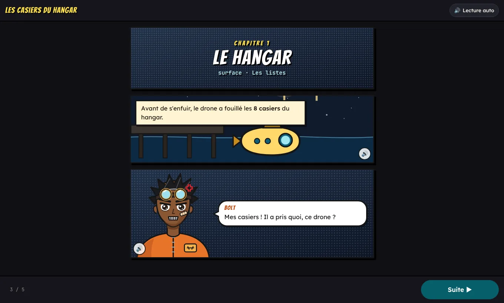

# 🐟 Expédition Gombessa

**Une plongée en Python à la recherche du cœlacanthe, racontée comme un manga, pour réviser les listes, les dictionnaires et les algorithmes de première.** Pour la terminale NSI, à la rentrée.

> Chaque élève devient « la Recrue », la voix de l'équipage du sous-marin *Luciole* auprès de LUCI, son IA de bord sabotée, qui ne comprend plus que Python : **sans son code, la Luciole n'avance pas**. Mission après mission, il faut toucher des cases, tracer des liens, compléter, corriger puis écrire des programmes pour atteindre les grottes du gombessa, à 250 m, avant le pilote rival. Après chaque réussite, la suite de l'histoire utilise le résultat du programme.

## 👉 [Essayer maintenant : babash.github.io/Rappel-1er](https://babash.github.io/Rappel-1er/)

**Gratuit · sans mot de passe · rien à installer · aussi sur téléphone · un prénom ou un pseudo, enregistré en ligne**

Expédition Gombessa fait partie des [Ressources NSI et SNT](https://babash.github.io/Babash-NSI-SNT/), rubrique [NSI Terminale](https://babash.github.io/Babash-NSI-SNT/nsi-terminale/).



---

## Une séance en trois étapes

1. **Tu** ouvres le [tableau de bord](https://babash.github.io/Rappel-1er/prof.html) et cliques sur **Créer mon espace** : le site te donne ton **lien personnel**, à enregistrer, car il n'y a pas de mot de passe. Tu crées une classe, puis **📣 Inviter les élèves** affiche le code de la classe, le lien et un **QR code** à projeter.
2. **Les élèves** scannent le QR code, ou ouvrent [le site](https://babash.github.io/Rappel-1er/) et choisissent **Je commence l'expédition**. Ils et elles tapent le code de la classe, un prénom ou un pseudo, puis choisissent un emblème. Le site leur donne leur **code d'expédition**, qui ne change jamais : à noter tout de suite. Compter 5 minutes pour le prologue et la visite guidée.
3. **Tu suis la classe en direct** : **À aider maintenant** signale les élèves qui bloquent, avec leur erreur la plus fréquente et leur travail. Au bout de 30 minutes, l'onglet **Missions** montre la notion à reprendre au tableau (souvent le maximum ou le comptage). Les élèves les plus rapides passent aux expéditions bonus, ou aident leurs camarades.

Tu veux d'abord découvrir le jeu seul·e ? Ajoute `?toutouvert` à l'adresse : [toutes les missions sont ouvertes](https://babash.github.io/Rappel-1er/?toutouvert), et le prologue devient facultatif.

## Ce que font les élèves

Chaque mission suit le même chemin : une **scène** de manga, qui se termine par une réplique à choisir (la bonne réponse est dans la scène) ; le **briefing** de LUCI, c'est-à-dire le rappel de cours ; l'**objectif**, en une phrase ; puis l'activité. Pour un programme, une étape **Avant de coder** fait d'abord expliquer le plan, en complétant une phrase avec des étiquettes : « Pour faire un total, je pars de … Je parcours la liste … À chaque tour, … l'élément au total. »

```python
# Mission 4, « Les traces du dugong » : compléter le programme de LUCI
traces = [4, 0, 7, 2, 5, 3]      # les traces comptées dans 6 zones

total = 0
for nb in ___:
    total = total + ___
print("Nombre de traces :", total)
```

### Le parcours principal (environ 1 h 15)

| # | Mission | Activité | Compétence | Notions |
|---|---|---|---|---|
| 1 | Les casiers du hangar | Phrase à compléter, cases à toucher | 🔍 Repérer | liste, indices, `-1`, `len`, `IndexError` |
| 2 | Réveiller LUCI | Console | ✍️ Écrire | lire, `len`, `append`, `liste[i] = x` |
| 3 | Le chargement de la soute | Emplacements et cases à toucher, liens | 💡 Comprendre | `append`, `insert`, `pop`, `remove`, `liste[i] = x` |
| 4 | Les traces du dugong | Plan + code à trous | 🧩 Compléter | parcours `for`, accumulateur |
| 5 | Bolt contre LUCI | Code à annoter, liens, phrase | 💬 Expliquer | parcours **par valeur** / **par indice** |
| 6 | La fiche du nudibranche | Plan + console | ✍️ Écrire | dictionnaire : clé, valeur, lire, modifier, ajouter, `in`, `len` |
| 7 | Le recensement du récif | Plan + lignes à ordonner | 📐 Concevoir | `.items()`, avant / dans / après la boucle |
| 8 | Le scanner saboté | Code à annoter + programme à corriger | 🔧 Corriger | filtre ; `:` oublié, `liste = liste.append()`, `<` / `>` |
| 9 | Compter les géantes | Plan + tableau d'avancement | 💡 Comprendre | compteur |
| 10 | Le point le plus profond | Phrase, cases et lignes à toucher, liens | 💬 Expliquer | algorithme du maximum (animation) |
| 11 | La lumière la plus forte | Plan + code à trous | 🧩 Compléter | maximum **et sa position** (parcours par indice) |
| 12 | Le registre des grottes | Plan + lignes à ordonner | 📐 Concevoir | compter avec un dictionnaire (2 niveaux de décalage) |
| 13 | La rencontre | Plan + programme à écrire | ✍️ Écrire | compter + maximum, sans `max` |

### Les expéditions bonus (ouvertes après la rencontre, dans l'ordre qu'on veut)

| Expédition | Missions | Notions |
|---|---|---|
| 🧫 Le lac Dziani | 6 | découpage, **copie / référence**, `insert` / `extend` / `del`, `enumerate`, tableau d'avancement de `est_triee`, paramètre par défaut |
| 📊 Le grand recensement | 6 | liste de listes avec en-tête, maximum dans un tableau, dictionnaire de dictionnaires, requêtes en console, clé variable, choix de structure |
| 🎶 Le chant des baleines | 5 | tuples (immuables, déballage), **modulo**, grille et boucles imbriquées, maximum avec position `(i, j)`, recherche « pour tous » |
| 🐢 Les plages des tortues | 5 | dictionnaire de tuples, densité maximale, remplacer un tuple, regrouper en listes, tableau d'avancement d'un minimum (et son piège) |
| 🌿 Retour à la mangrove | 5 | tri par sélection, **rechercher un élément**, compter puis maximum, choisir un algorithme et estimer son coût, rapport final sur une liste de dictionnaires |

## Pour quels usages

| Usage | Comment |
|---|---|
| **Une séance en classe** (≈ 1 h 15 pour le parcours principal) | Les 13 missions, scènes et briefings compris, avec le suivi en direct. La durée est comptée pour les élèves en difficulté. |
| **Sur plusieurs séances** | Avec son code d'expédition, chaque élève reprend depuis n'importe quel ordinateur ou téléphone. Les tirets, majuscules et accents ne comptent pas. |
| **Sur téléphone** | Des planches verticales façon webtoon, une colonne, de gros boutons et la barre d'outils en bas. |
| **Pour les élèves les plus à l'aise** | 5 expéditions bonus, soit 27 missions de plus en plus exigeantes. |
| **Pour les lecteur·rice·s en difficulté** | Chaque case de la scène se lit à voix haute (🔊, **Lecture auto**), comme l'objectif, les étapes et le briefing. Des écouteurs aident beaucoup. |
| **Sans classe** | **Jouer sans compte** : la progression reste un jour sur l'appareil, et **Sauvegarder pour un autre jour** donne un code `GB-…` pour continuer plus tard. |
| **Avec des collègues** | Chaque collègue crée son propre espace depuis la même adresse. Pour animer une classe à deux, il suffit de partager son lien. |

## Pourquoi ça marche

- **L'histoire fait avancer le jeu** : chaque mission a une raison d'être dans le récit, et la réplique de fin de scène vérifie que la demande est comprise.
- **Souvent sans coder** : toucher une case ou une ligne, tracer des liens, compléter une phrase avec des étiquettes, annoter du code, remettre des lignes dans l'ordre, remplir un tableau d'avancement, plutôt que des QCM.
- **Mettre des mots sur son code** : « `fiche` est un dictionnaire », « c'est un parcours par indice »… Le mémo commence par « Les mots pour expliquer ».
- **Des aides graduées, jusqu'à la correction** : selon l'activité, une explication ciblée après une erreur, ou trois indices progressifs (après des essais ou un délai), puis la réponse ou la correction. LUCI intervient quand un·e élève enchaîne les erreurs ou n'ose pas lancer son code.
- **Les erreurs Python traduites** en français simple, avec la ligne fautive et une piste précise ; le message d'origine reste affiché, pour apprendre à le lire. L'éditeur a la coloration, l'indentation en bandes de couleur et l'autocomplétion en français.
- **L'équipage plutôt que le classement** : chaque élève voit ses camarades avancer, sans classement de vitesse. 7 compétences suivies ; XP, rangs, 22 badges, emblèmes et 6 thèmes à débloquer.

Les données des exercices sont inventées ; les faits du carnet de bord sont vérifiés. Il n'y a ni police ni autorité dans l'histoire : l'équipage gagne en **publiant ses données**. Le détail : **[docs/GUIDE.md](docs/GUIDE.md)**.

## Données des élèves

- **Enregistré en ligne** (Supabase), pour le suivi de classe : la classe, un **prénom ou un pseudo**, le code d'expédition, la progression et les essais. Pas d'adresse électronique, pas de nom de famille : conseiller un prénom ou un surnom.
- **Visible par les autres** : de ses camarades, chaque élève ne voit que le pseudo, l'emblème et l'avancement, jamais leur code. Toi, tu ne vois que **tes** classes et **tes** élèves.
- **Sur l'appareil** : des cookies d'un jour, strictement nécessaires au jeu (ni publicité ni mesure d'audience), et les brouillons dans l'onglet ouvert.
- **Pour effacer** : tu peux supprimer à tout moment un·e élève, une classe ou tout ton espace (suppression définitive).

Le détail : [docs/DONNEES.md](docs/DONNEES.md).

## Pour aller plus loin

| Document | Contenu |
|---|---|
| [Guide de la séance](docs/GUIDE.md) | Le déroulé d'une mission, ce qui aide les élèves, le tableau de bord, les conseils de déroulement |
| [Données et sécurité](docs/DONNEES.md) | Le code d'expédition, les cookies d'un jour, le jeu sans Supabase, ce qui est enregistré et qui y accède |
| [Installer sa copie](docs/INSTALLER.md) | Mettre le site sur GitHub Pages, brancher Supabase, les espaces sans mot de passe, le dépannage |
| [Architecture](docs/ARCHITECTURE.md) | Modifier ou ajouter des missions, le vérificateur, les tests, les fichiers du dépôt, les sources du carnet de bord |

## Contact

Conçu par Babash - NSI Tani Malandi pour les classes de NSI de terminale de l'académie de Mayotte, développé avec l'aide de l'IA ([Claude Code](https://claude.com/claude-code)).
Une question, une idée, un bug ? Les [issues GitHub](https://github.com/babash/Rappel-1er/issues) du dépôt. Toutes les ressources sont sur le site [Ressources NSI et SNT](https://babash.github.io/Babash-NSI-SNT/).

## Licence

- **Le code** (les fichiers `.html`, `.css`, `.js` et `.py`, et `supabase/schema.sql`) est sous licence [MIT](LICENSE), sauf ce qui suit.
- **Les documents** (les missions, le mémo et l'histoire de `js/data/`, les illustrations originales des personnages, des sous-marins, des espèces et des décors, et les guides et les images de `docs/`) sont sous licence [CC BY-SA 4.0](https://creativecommons.org/licenses/by-sa/4.0/deed.fr).
- **[Pyodide](https://pyodide.org)** (Python dans le navigateur, `vendor/pyodide/`) : licence MPL-2.0.
- **[Ace](https://ace.c9.io)** (l'éditeur de code, `vendor/ace/`) : licence BSD.
- **[qrcode-generator](https://github.com/kazuhikoarase/qrcode-generator)** de Kazuhiko Arase (`vendor/qrcode/`) : licence MIT. « QR Code » est une marque déposée de DENSO WAVE.
- **Les polices** Lexend, Bricolage Grotesque, Bangers et JetBrains Mono : licence SIL OFL, par Google Fonts.

Tu peux les réutiliser et les modifier, y compris pour tes classes, en mentionnant Babash - NSI Tani Malandi et la licence ; un document modifié se partage sous la même licence. Si tu utilises l'IA pour les modifier, merci de le préciser.
